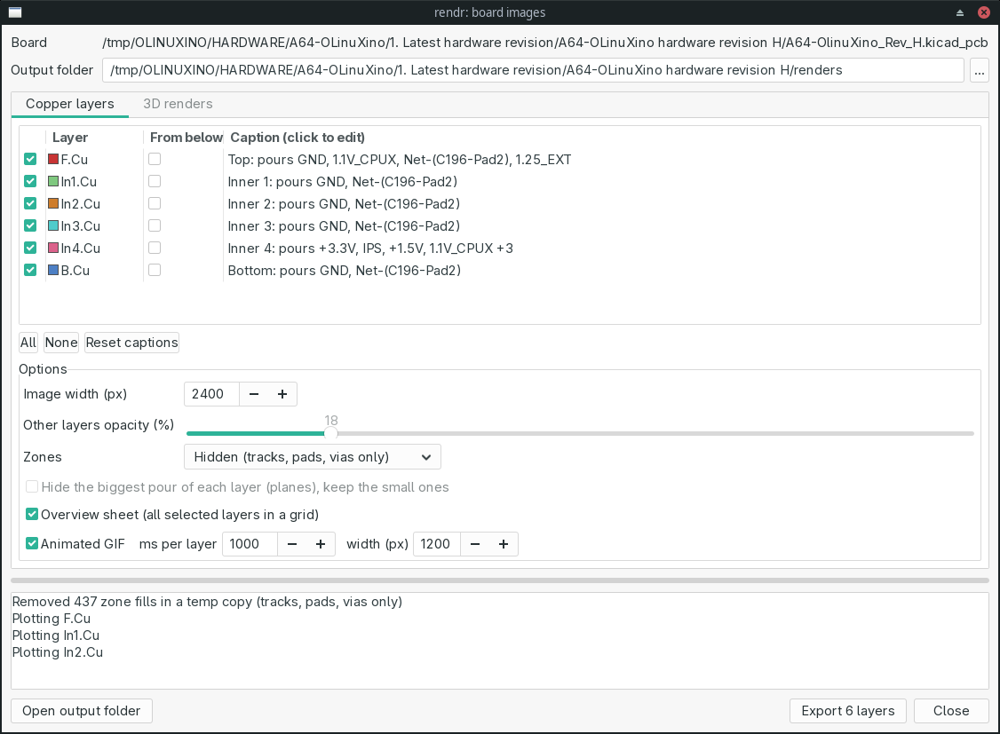
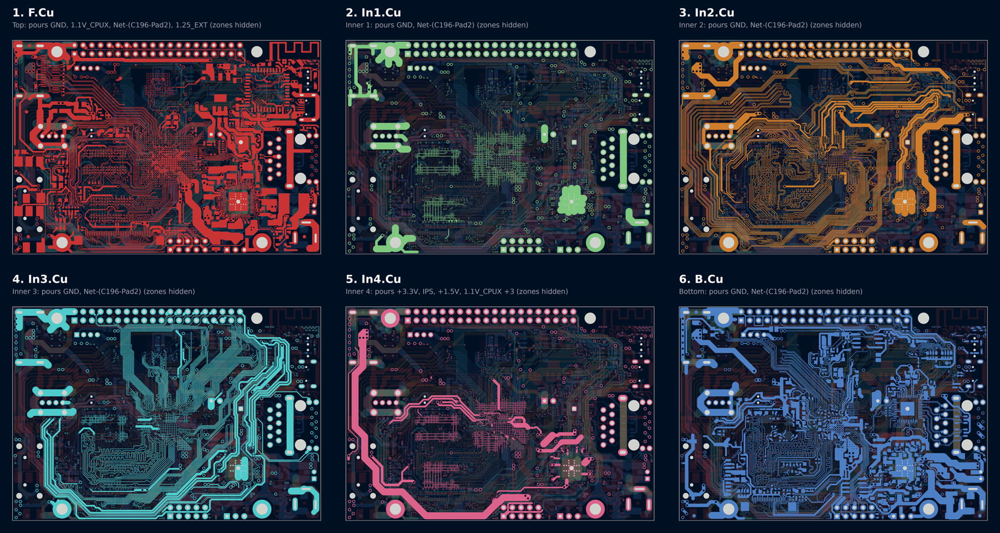
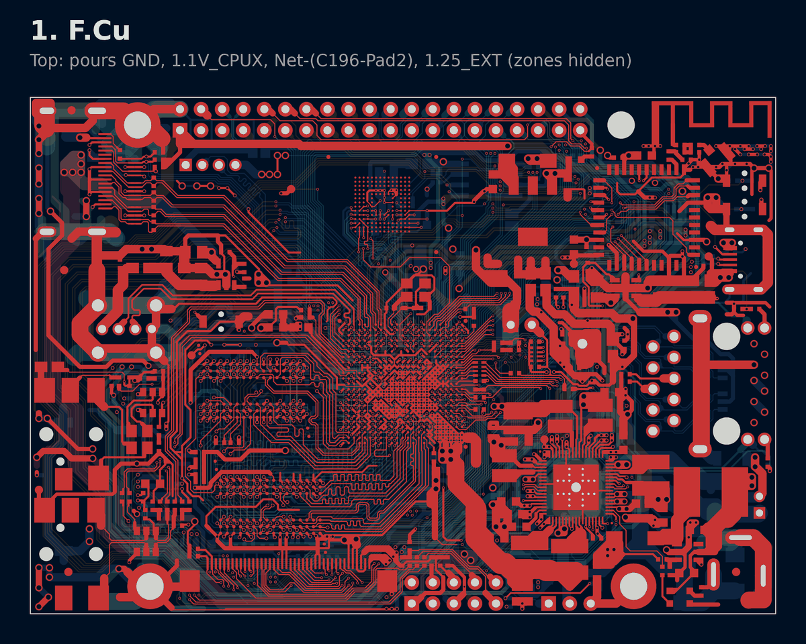
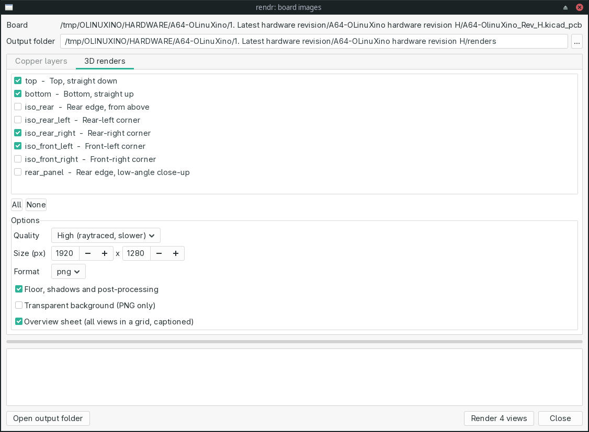
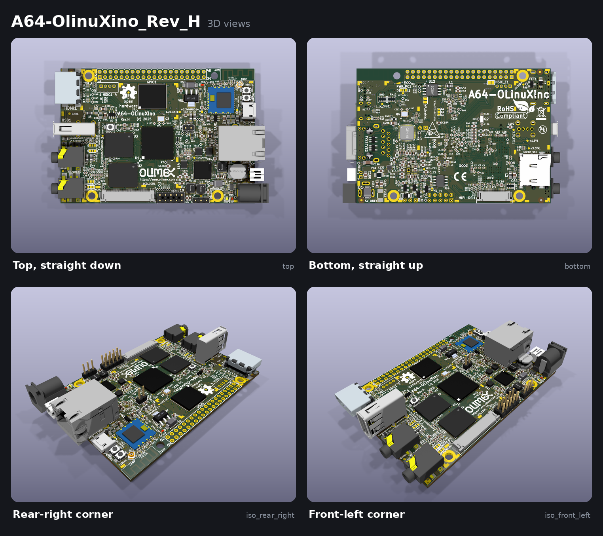

# rendr

A KiCad 10 action plugin that makes pictures of your board for reviews, reports
and READMEs:

- **Copper layers**: one image per copper layer in KiCad's "highlighted layer"
  look (that layer in full colour, the others dimmed underneath, board outline),
  an overview sheet and an animated GIF.
- **3D renders**: raytraced views from several camera angles, plus a captioned
  overview sheet.

Pick what you want in a window, click Run. KiCad stays usable while it works
(the window is modeless, the rendering runs in the background).

The examples below are the [A64-OLinuXino](https://github.com/OLIMEX/OLINUXINO)
rev. H by Olimex, a 6-layer open-source board (see [Credits](#credits)).

## Copper layers



- **Tick** the layers to export. Every copper layer is still drawn dimmed
  underneath, so each image shows the layer in context.
- **From below** mirrors that image, as if you were looking at the bottom of the board.
- **Caption** is the line under the title. It starts with the layer's user name
  (or Top / Inner n / Bottom) and the nets poured on it. Click to edit it
  (`GND plane`, `+1V8 plane + power traces`...). Edits are remembered per board.
- **Zones**: *Refill* fills every zone in a temp copy first (the board file is
  never written), *As saved* plots the fills stored in the file, *Hidden* strips
  the pours to show tracks, pads and vias only.
- **Hide the biggest pour of each layer**: on every layer, the zone with the
  largest fill is left out if it covers at least a fifth of the board. Ground
  and power planes go, smaller pours (local supply islands, shield areas) stay,
  so you see the routing under the planes. The caption says which net was
  hidden (`GND pour hidden`). Command line: `--hide-biggest`.

Output (`<output>/copper_layers/`): `1_F_Cu.png`, `2_In1_Cu.png`, ...,
`0_overview.png`, `copper_layers.gif`.

Overview sheet (zones hidden):



Animated GIF:



## 3D renders



| view | camera |
| --- | --- |
| `top`, `bottom` | straight down / up |
| `iso_front_left`, `iso_front_right` | corners, from above, perspective |
| `iso_rear_left`, `iso_rear_right` | same, from the rear |
| `iso_rear` | rear edge, from above |
| `rear_panel` | rear edge, low angle (connectors on the rear edge) |

Every footprint type is shown, whatever your 3D viewer settings hide (THT,
SMD, virtual): kicad-cli runs with a temp copy of your KiCad config. *Basic*
quality is a quick preview, *High* is raytraced (a few seconds per view on a
desktop CPU, more for large images).

Output (`<output>/3d/`): `1_top.png`, `2_bottom.png`, ..., `0_overview.png`.



## Good to know

- rendr works on the **board file on disk**: save (Ctrl+S) first. The window
  warns you when the editor has unsaved changes.
- The board is only read. Copper exports work on a temp copy; 3D renders read
  the board in place because 3D model paths are often relative to the project
  (`${KIPRJMOD}/...`).
- The default output folder is `renders/` next to the board. The window
  remembers your options (and, per board, layers, captions and output folder) in
  `rendr.json` in KiCad's config folder.
- **Cancel** stops the running kicad-cli and cleans up the temp files.

## Install

Clone (or link) into KiCad's plugin folder, then restart the PCB editor (or
Tools > External Plugins > Refresh Plugins):

```sh
# Linux
ln -s ~/Documents/kicad_plugins/rendr ~/.local/share/kicad/10.0/scripting/plugins/rendr
# Windows
git clone git@github.com:suguuss/rendr.git "%USERPROFILE%\Documents\KiCad\10.0\scripting\plugins\rendr"
```

The action is **rendr: Board Images** (toolbar button and Tools > External Plugins).

Needs:

- KiCad 9 or 10 (uses `kicad-cli pcb render`, found next to KiCad if not on PATH).
- **Pillow** in KiCad's Python. Linux distro packages use the system Python
  (`python-pillow`). On Windows, from the *KiCad Command Prompt*:
  `python -m pip install pillow`.
- SVG rasterising uses `wx.svg`, shipped with KiCad's wxPython. `rsvg-convert`
  is used if `wx.svg` is missing.

## Command line

The same exports without the window. Run from the folder that contains `rendr/`:

```sh
python3 -m rendr copper board.kicad_pcb                     # all layers -> renders/copper_layers
python3 -m rendr copper board.kicad_pcb --layers F.Cu,B.Cu --from-below B.Cu \
    --caption "In1.Cu=GND plane" --zones hidden --gif -o out/
python3 -m rendr 3d --list                                  # available views
python3 -m rendr 3d board.kicad_pcb --views top,iso_front_left --quality basic
python3 -m rendr 3d board.kicad_pcb --width 2560 --height 1600 --transparent
```

`python3 -m rendr copper -h` / `3d -h` list every option. The command line needs
a Python that can `import pcbnew` (KiCad's own on Windows/macOS) for the copper
stack.

## Files

| file | what |
| --- | --- |
| `plugin.py` | the KiCad action, keeps one window open |
| `dialog.py` | the window: lists, options, background run, settings |
| `copper.py` | copper layer images, overview, GIF |
| `render3d.py` | 3D views, temp KiCad config, overview |
| `boardinfo.py` | copper stack, layer colours, default captions |
| `common.py` | kicad-cli lookup, cancellable runs, overview grid |
| `__main__.py` | command line |

## Credits

Example images: [A64-OLinuXino](https://github.com/OLIMEX/OLINUXINO/tree/master/HARDWARE/A64-OLinuXino)
hardware revision H by [Olimex Ltd](https://www.olimex.com), from the
[OLIMEX/OLINUXINO](https://github.com/OLIMEX/OLINUXINO) repository, licensed
under [CC BY-SA 3.0 US](https://creativecommons.org/licenses/by-sa/3.0/us/).
The renders in `docs/` were made with rendr from the unmodified design and are
shared under the same license. OLinuXino is a trademark of Olimex Ltd.
